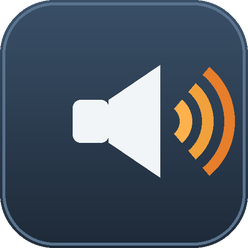

# SoundTest for Amazfit Bip 6

A test Mini Program for **Amazfit Bip 6** ([Zepp OS](https://docs.zepp.com/) 5.0,
API_LEVEL 4.2, 390×450) to explore what a third-party app can do with sound and haptics.



## Screens

| Screen | API | Buttons |
|---|---|---|
| System sounds | `SystemSounds` from `@zos/sensor` | 8 built-in ringtones: ALARM, MESSAGE, REGULAR, ACHIEVE, CAMERA, ABN_HIGH, ABN_LOW, SOS |
| Buzzer | `Buzzer` from `@zos/sensor` | 6 beep scenes: ALARM, REMIND_1, REMIND_2, OPERATE, SUCCESS, FAILURE |
| Vibration | `Vibrator` + `VIBRATOR_SCENE_*` from `@zos/sensor` | 9 haptic scenes, from short taps to call/timer patterns |

Each screen has a **Stop** button, navigation to the next screen, and a bottom line
showing the name of the last triggered sound (or why it is silent).

## Key findings (verified on a real Bip 6)

- **No `Buzzer` sensor on Bip 6** — `new Buzzer()` throws, same as in the simulator.
  All audible output goes through `SystemSounds` (speaker), all haptics through `Vibrator`.
- **No custom audio playback API exists** — `@zos/*` has no media/audio module, so an app
  can only trigger built-in sounds, not bundle its own audio files.
- No `permissions` needed for any of the sound/vibration APIs.
- If the watch's *Settings → Sound & vibration* scenes are OFF, `start()` silently no-ops.

## Toolchain

- Node.js LTS, [`@zeppos/zeus-cli`](https://www.npmjs.com/package/@zeppos/zeus-cli) (`npm i -g`),
  [Zepp OS Simulator v2](https://docs.zepp.com/guides/tools/simulator/download/),
  VS Code + *Zepp OS Dev Tools* extension.

## Run it

```bash
cd soundTest
# live preview on the simulator (needs Device Simulator open, 390x450 image selected)
zeus dev --simulatorHost 127.0.0.1 --simulatorPort 7650 -t "Amazfit Bip 6"

# install on the real watch via QR (phone scans it in the Zepp app, Developer Mode on)
zeus preview -t "Amazfit Bip 6"

# ...or push directly over Developer Bridge (phone: same account, + → Bridge, watch nearby)
zeus bridge
bridge$ connect        # pick app-Android
bridge$ install --target "Amazfit Bip 6"
```

> Behind a proxy, `zeus` fails to fetch the device list and upload the preview
> (`ERR_FR_TOO_MANY_REDIRECTS`). Seed `~/.zepp/.zeus_devices` from the CDN JSON
> (curl works where the CLI's HTTP client doesn't) and bypass the proxy for uploads:
> `HTTPS_PROXY= HTTP_PROXY= NO_PROXY='*' zeus preview …`

## Project layout

```
app.json            # appId 21845, pages: page/sounds, page/buzzer, page/vibro
app.js              # plain App (no phone bridge needed — device-local app)
page/sounds.js      # SystemSounds screen
page/buzzer.js      # Buzzer screen
page/vibro.js       # Vibrator screen
page/*.s.layout.js  # per-target layouts (s = square 390x450)
assets/default.s/   # app icon (Bip 6 target)
```

`zeus build` produces `dist/<appId>-SoundTest-<version>-<timestamp>.zab`.
